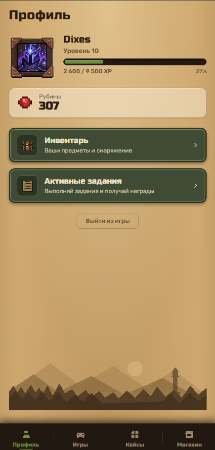
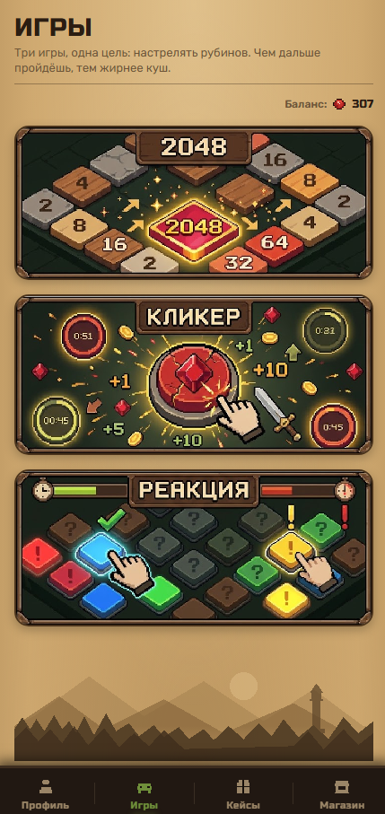
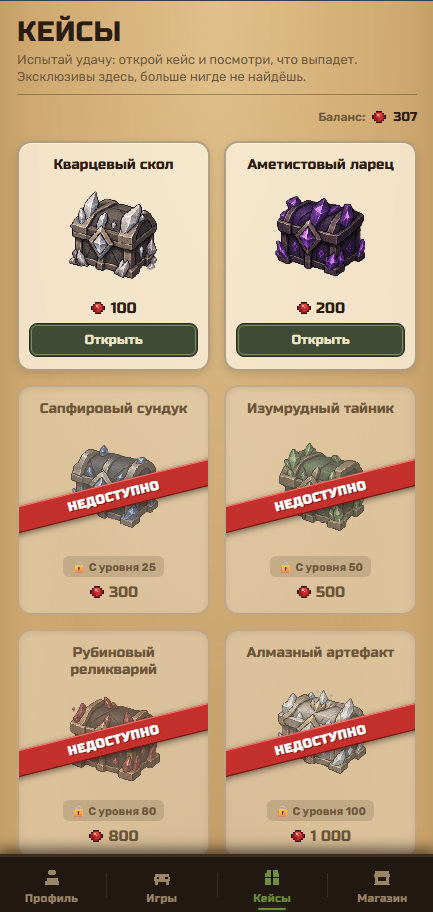
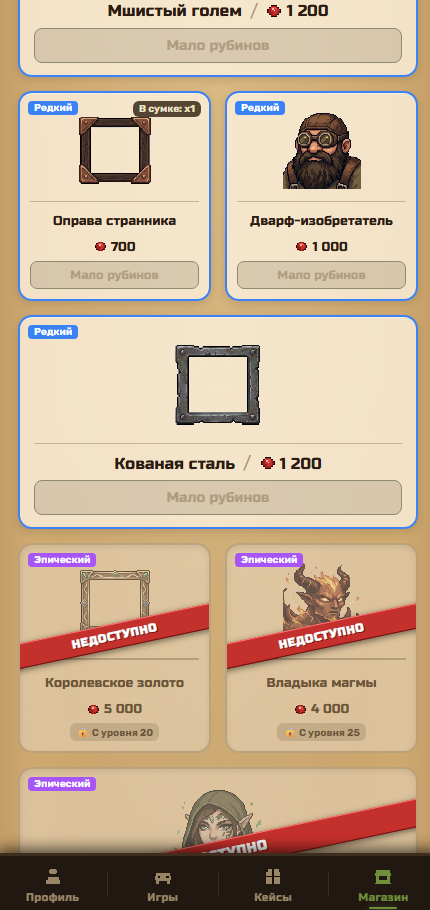
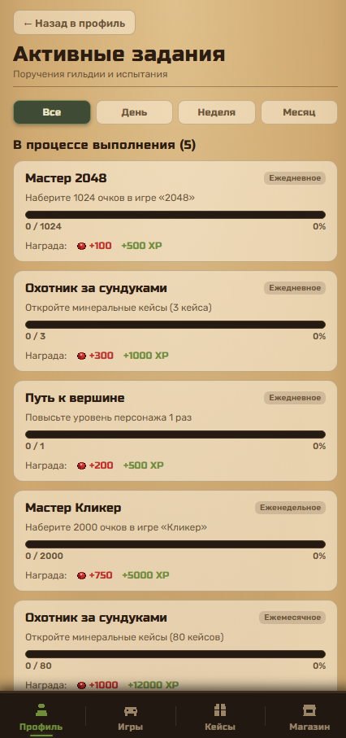
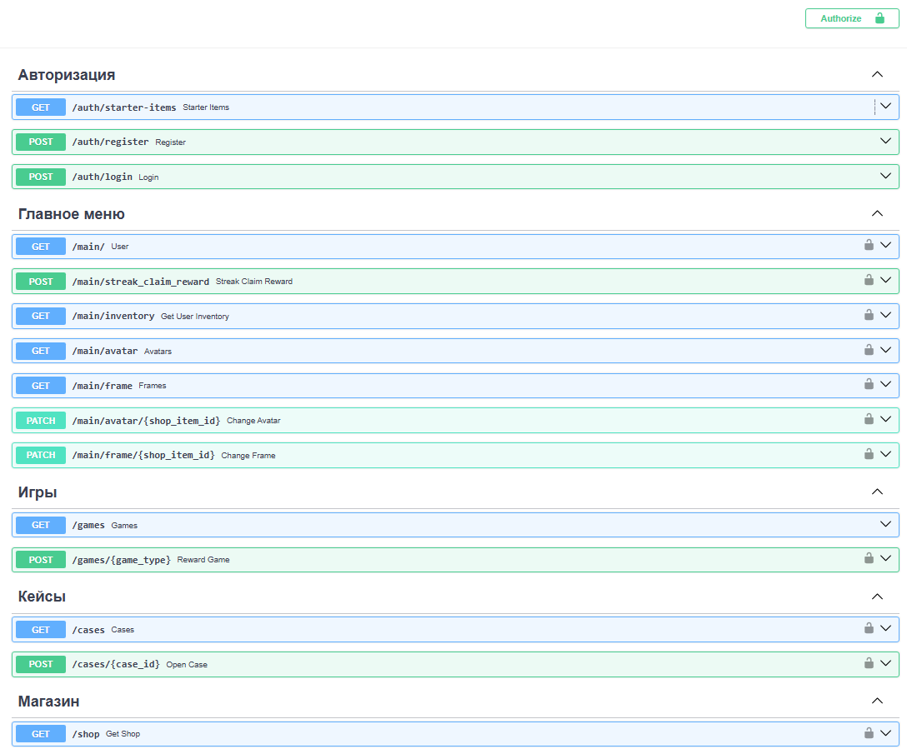

# 🎮 GameSite — Игровая веб-платформа с RPG-прогрессией

[](https://www.python.org/)
[](https://fastapi.tiangolo.com/)
[](https://www.sqlalchemy.org/)
[](https://www.postgresql.org/)
[](https://alembic.sqlalchemy.org/)
[](https://react.dev/)
[](https://vitejs.dev/)

Полнофункциональная веб-платформа с элементами RPG и геймификации: система прокачки уровней и опыта (XP), внутренняя валюта (рубины), открытие минеральных кейсов с взвешенным дропом, магазин косметических предметов (аватарки и рамки), 3 встроенные мини-игры, ежедневные/еженедельные задания и система ежедневных наград за стрик посещений.

---

## 📸 Галерея проекта (Скриншоты)

> Все скриншоты интерфейса собраны ниже. Интерфейс выполнен в ретро-фэнтези / pixel-art эстетике и оптимизирован под mobile-first отображение (по центру десктопного экрана).

### 1. Профиль игрока


### 2. Мини-игры


### 3. Открытие минеральных кейсов


### 4. Магазин предметов



### 5. Система заданий (Квесты)


### 6. Документация API (FastAPI Swagger UI)


---

## 🛠 Зоны ответственности: что сделано мной / роль ИИ

Проект создавался как комплексный pet-проект с упором на **Python Backend**.

| Область | Авторство | Детали реализации |
| :--- | :---: | :--- |
| **Backend (Python)** | **100% Авторская работа** | Архитектура слоев, проектирование схемы БД (10 таблиц, Check-констрейнты, связи), асинхронный движок (SQLAlchemy 2.0 Async + asyncpg), сервисный слой бизнес-логики, планировщик задач APScheduler, JWT-аутентификация. *(ИИ использовался точечно как ментор для консультаций в узких моментах: сложные запросы SQLAlchemy, тонкости cron-триггеров APScheduler)* |
| **Frontend (React)** | **AI-Generated + Авторский супервайзинг** | Клиентская часть сгенерирована нейросетью по моему подробному ТЗ и дизайн-системе. Я выступал в роли тимлида/постановщика задач: формулировал промты, отлаживал некорректное поведение, устранял баги взаимодействия с API и связывал клиент с серверной частью. |

---

## 🧱 Архитектура и технологии Backend

Бэкенд спроектирован по принципам чистой архитектуры с разделением ответственности:

```
backend/
├── alembic/                # Миграции структуры базы данных
├── app/
│   ├── api/v1/             # Транспортный уровень (FastAPI Routers + Dependency Injection)
│   │   ├── routers/        # auth, users, cases, games, shop, tasks
│   │   └── deps.py         # Зависимости: получение текущего юзера по JWT, доступ к БД
│   ├── core/               # Ядро: конфигурация (Pydantic Settings), безопасность, лексикон
│   ├── db/                 # Слой данных: сессии SQLAlchemy, базовый класс моделей
│   │   └── models/         # 10 декларативных моделей данных с типизацией Mapped
│   ├── schemas/            # Pydantic v2 DTO (валидация входных/выходных данных)
│   ├── service/            # Слой чистой бизнес-логики (Service Layer)
│   └── image/              # Статические файлы (спрайты аватарок, рамок и кейсов)
├── scripts/                # Сиды для первичного наполнения БД (seed.py)
└── main.py                 # Точка входа, CORS, lifespan, APScheduler
```

### Ключевые архитектурные решения

1. **Сервисный слой (Service Layer):**
   Роутеры в `api/v1/routers` тонкие — они отвечают только за валидацию запроса, вызов соответствующего сервиса и формирование HTTP-ответа. Вся бизнес-логика (расчет опыта, ротация квестов, взвешенный рандом кейсов, покупка/продажа) вынесена в изолированные сервисы (`user_service.py`, `case_service.py`, `task_service.py` и др.). Это упрощает поддержку и модульное тестирование.

2. **Асинхронная работа с БД (SQLAlchemy 2.0 + asyncpg):**
   - Все запросы выполняются асинхронно через `AsyncSession` и `async_sessionmaker`.
   - Использование `selectinload` и `joinedload` для предотвращения проблемы N+1 при загрузке связей (инвентарь, шаблоны задач).
   - Пул соединений (`pool_size=10`).

3. **Фоновый планировщик задач (APScheduler):**
   - Интегрирован в FastAPI через асинхронный контекстный менеджер `lifespan`.
   - Настроена автоматическая генерация и ротация задач по часовому поясу `Europe/Moscow`:
     - Ежедневные задачи — каждый день в 00:00 (cron).
     - Еженедельные задачи — каждый понедельник в 00:00.
     - Ежемесячные задачи — 1-го числа каждого месяца.

4. **Событийная модель прогресса заданий (Event-Driven Updates):**
   Проверка квестов не требует тяжелых фоновых опросов базы. Сервис `task_service.register_task_event` вызывается точечно по факту наступления игрового события:
   - Завершение раунда игры (`game_service`) → обновление игровых заданий.
   - Повышение уровня игрока (`user_service`) → проверка условий `pass_levels`.
   - Открытие кейса (`case_service`) → инкремент счетчика `open_case`.

5. **Целостность данных и защита экономики на уровне БД:**
   - В моделях БД объявлены строгие `CheckConstraint`:
     - Баланс рубинов не может быть отрицательным (`rubies >= 0`).
     - Уровень ограничен диапазоном `1..100`.
     - Количество предметов в инвентаре не может быть меньше 0.
   - Все изменения баланса логируются в отдельную таблицу `transactions` с указанием причины (`reason`), что исключает незаметную утечку игровой валюты и помогает в отладке.

6. **Аутентификация и безопасность:**
   - Stateless-авторизация на основе JWT (`python-jose`).
   - Безопасное хэширование паролей через `passlib` (алгоритм `bcrypt`).
   - Dependency Injection для защищенных эндпоинтов (`get_current_user`).

---

## 🗄 Модели базы данных (Схема)

Проект использует реляционную СУБД **PostgreSQL**. Реализовано 10 связанных таблиц:

- `users` — профиль игрока, уровень, общий XP, баланс рубинов, ссылки на текущий аватар и рамку.
- `streak` — прогресс ежедневного входа (текущая серия, рекорд, дата последнего клейма).
- `shop_item` — каталог предметов (аватарки, рамки) с типами редкости, ценой покупки и продажи.
- `inventory` — предметы игроков с поддержкой дубликатов (`quantity`) и источником получения (`source`).
- `case` — минеральные кейсы с ограничением доступа по уровню (`unlock_level`).
- `case_item` — лут-таблица кейса с весами (`weight`) для выпадения рубинов, XP или предметов магазина.
- `user_case_history` — аудит-лог открытий кейсов (задел под pity-систему).
- `task_template` — шаблоны заданий (день/неделя/месяц, условия, награды).
- `user_task` — прогресс конкретного пользователя по активному заданию.
- `current_tasks` — актуальный глобальный пул ротации заданий.
- `game_session` — история игровых сессий с набранными очками и заработанной валютой.
- `transactions` — финансовый аудит кошелька пользователя.

---

## 💻 Frontend (Клиентская часть)

- **Стек:** React 18, Vite, Vanilla CSS.
- **Дизайн-система:** авторский ретро-стиль (пергамент, оливковые панели, стилизация под 16-битный пиксель-арт RPG интерфейс). Все цвета и отступы вынесены в CSS-переменные.
- **Интерактивные мини-игры:**
  1. **Кликер с таймером:** динамический кликер с редкими бонусными целями (x2/x3 очков).
  2. **Тест на реакцию:** цветные вспыхивающие плитки с возрастающей сложностью и ограничением по времени.
  3. **2048:** классическая логическая головоломка со сдвигом плиток и расчетом награды от максимального номинала.
- **Взаимодействие с API:** централизованный HTTP-клиент на `fetch` с автоматической подстановкой Bearer токена и обработкой ошибок.

---

## 🚀 Инструкция по запуску проекта

### Требования
- Python 3.11+
- Node.js 18+ и npm
- PostgreSQL 15+

### 1. Клонирование репозитория
```bash
git clone https://github.com/Dixes6/gamesite.git
cd gamesite
```

### 2. Настройка Backend

1. Перейдите в папку бэкенда и создайте виртуальное окружение:
```bash
cd backend
python -m venv .venv

# Активация на Windows (PowerShell):
.venv\Scripts\Activate.ps1
# Активация на Linux/macOS:
source .venv/bin/activate
```

2. Установите зависимости:
```bash
pip install -r requirements.txt
```

3. Настройте переменные окружения:
Создайте файл `.env` в папке `backend/` по примеру `.env.example`:
```ini
POSTGRES_USER=postgres
POSTGRES_PASSWORD=your_password
POSTGRES_HOST=localhost
POSTGRES_PORT=5432
POSTGRES_DB=gamesite

SECRET_KEY=your_super_secret_jwt_key_here
ALGORITHM=HS256
ACCESS_TOKEN_EXPIRE_MINUTES=60

LOG_LEVEL=INFO
LOG_FORMAT=%(levelname)-7s: %(asctime)s - %(name)10s - %(message)s
```

4. Примените миграции базы данных (Alembic):
```bash
alembic upgrade head
```

5. Заполните базу начальными игровыми данными (сидами):
```bash
python scripts/seed.py
```

### 3. Настройка Frontend

В отдельном окне терминала:
```bash
cd frontend
npm install
```

### 4. Запуск серверов

**Вариант А: Быстрый запуск одним кликом (Windows):**
В корне проекта находятся готовые скрипты запуска:
- Двойной клик по `start_dev.bat` (или запуск `start_dev.ps1` в PowerShell).
- Скрипт автоматически запустит FastAPI (порт 8000) и Vite (порт 5173) в двух отдельных окнах.

**Вариант Б: Ручной запуск:**
- **Backend:**
  ```bash
  cd backend
  uvicorn main:app --reload --port 8000
  ```
- **Frontend:**
  ```bash
  cd frontend
  npm run dev
  ```

После запуска:
- Приложение доступно по адресу: **http://localhost:5173**
- Интерактивная документация Swagger API: **http://localhost:8000/docs**

---

## 👤 Автор

**Данил** — Начинающий Python Backend-разработчик
- **Telegram:** [@dixesss](https://t.me/dixesss) 

- **AI-ассистент:** [Google Antigravity](https://deepmind.google/) —
   архитектурные консультации, код-ревью и генерация фронтенд-компонентов по ТЗ.

